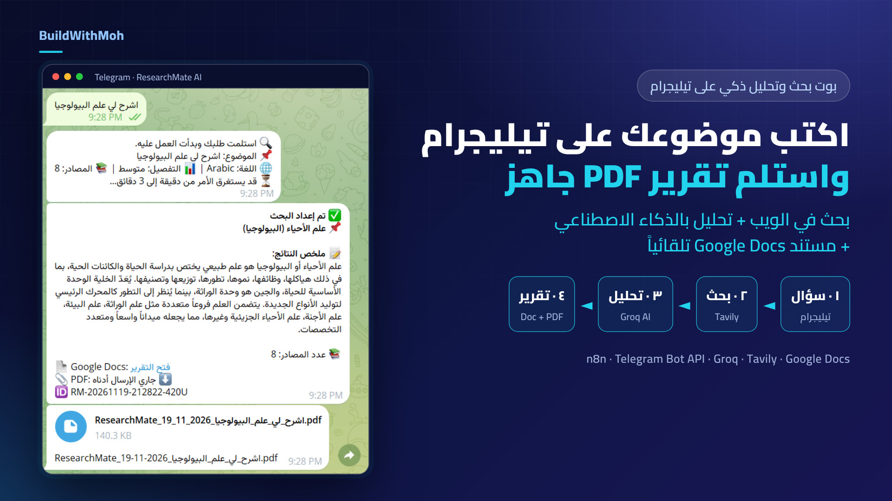
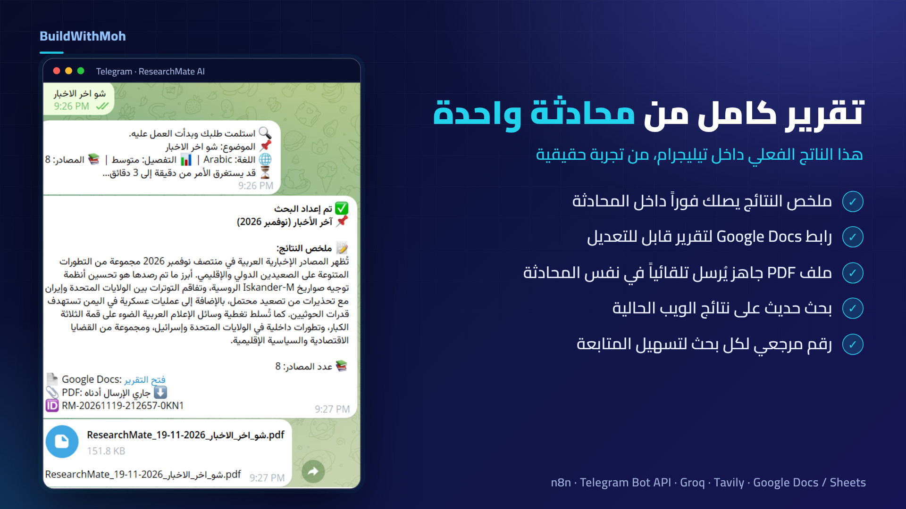
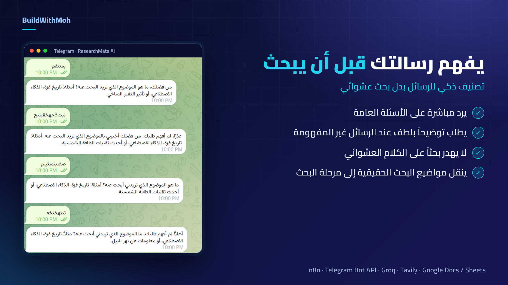
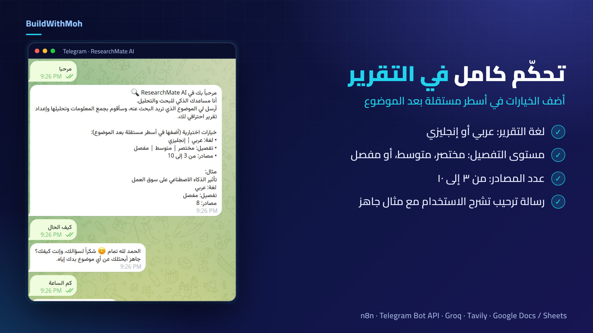
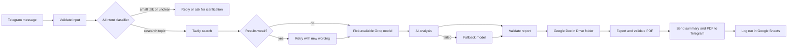
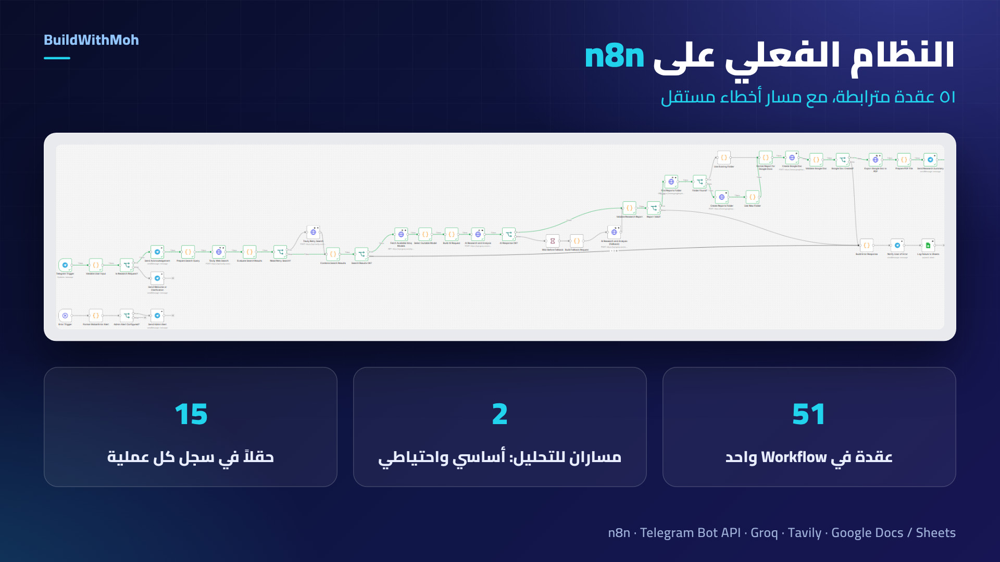
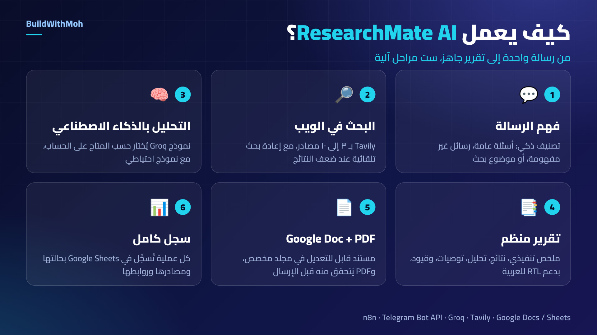

<div align="center">



# ResearchMate AI

**A Telegram research agent built on n8n.**
Send a topic. Get a structured, source-backed report as an editable Google Doc and a PDF.

`n8n` · `Telegram Bot API` · `Groq LLM` · `Tavily` · `Google Docs / Drive / Sheets` · `JavaScript`

[العربية](#-النسخة-العربية) · [English](#english)

</div>

---

## English

ResearchMate AI is a Telegram bot built on n8n that turns a topic into a researched report. A user sends a topic. The bot searches the web, analyses the sources with an LLM, and delivers a structured report as an editable Google Doc and a PDF, in the same chat.

### Demo

| Real report in Telegram | Smart intake | Report options |
|---|---|---|
|  |  |  |

### Key features

- **Smart intake.** An AI classifier answers small talk directly, politely asks for clarification on gibberish, and sends real topics to research. Users can set report language, detail level, and number of sources.
- **Web research.** Tavily search (3 to 10 sources, default 8) with an automatic retry using different wording when results are weak.
- **AI analysis.** The Groq model is selected dynamically from the models available on the account, with a fallback model on failure.
- **Deliverables.** A Google Doc (RTL-aware for Arabic) in an auto-created Drive folder, exported to a validated PDF and sent back to the same chat.
- **Audit log.** Every run is recorded in Google Sheets with status, sources, and links.

### Reliability and safety

- The sources list is built by code from real search results. Unverified URLs and citations are stripped from the model output.
- Web content is treated as untrusted data, which reduces prompt-injection risk.
- Full error handling: clear user-facing messages, failure logging, bounded retries, and no duplicate document creation.
- Formula-injection protection in Sheets and API-key redaction in error messages.
- A separate error workflow with an optional Telegram alert to the admin.

### How it works





### Setup

**Requirements:** an n8n instance (self-hosted or cloud), a Telegram bot token from [@BotFather](https://t.me/BotFather), a [Tavily](https://tavily.com) API key, a [Groq](https://console.groq.com) API key, and a Google account (Drive and Sheets).

1. **Create the log spreadsheet.** In Google Sheets create a spreadsheet (for example `ResearchMate_Research_History`) with a tab named `Research History`. Put these headers in row 1:

   `Research ID` · `Date` · `Time` · `Telegram User ID` · `Telegram Chat ID` · `Username` · `Research Topic` · `Research Language` · `Report Detail Level` · `Number of Sources` · `Sources URLs` · `Google Docs URL` · `PDF File Name` · `Status` · `Error Details`

2. **Import the workflow.** In n8n choose *Import from file* and select [`workflow/ResearchMate_AI_workflow.json`](workflow/ResearchMate_AI_workflow.json).

3. **Create the credentials** and assign them to the nodes that show a `REPLACE:` credential:

   | Credential type | Used for | Notes |
   |---|---|---|
   | Telegram API | Trigger and all Telegram nodes | Token from BotFather |
   | Header Auth (Tavily) | `Tavily Web Search`, `Tavily Retry Search` | Name `Authorization`, value `Bearer <TAVILY_KEY>` |
   | Header Auth (Groq) | `Fetch Available Groq Models`, `AI Intent Classifier`, `AI Research and Analysis` (+ fallback) | Name `Authorization`, value `Bearer <GROQ_KEY>` |
   | Google Drive OAuth2 | Folder lookup/creation, Doc creation, PDF export | |
   | Google Sheets OAuth2 | `Save Research History`, `Log Failure to Sheets` | |

4. **Fill the placeholders** (search the workflow for `REPLACE`):
   - `REPLACE_WITH_YOUR_SPREADSHEET_ID` in the `CONFIG` block of the **Validate User Input** node, and in the document field of **Save Research History** and **Log Failure to Sheets**.
   - In the same two Sheets nodes, select the `Research History` tab.
   - Optional: `ADMIN_CHAT_ID` in **Format Global Error Alert** to receive error alerts on Telegram. Leave it as is to disable alerts.

5. **Optional tuning** in the `CONFIG` block of **Validate User Input**: `FOLDER_NAME` (Drive folder, auto-created if missing), `DEFAULT_SOURCES`, `MIN_SOURCES`, `MAX_SOURCES`, `MAX_TOPIC_CHARS`. The code uses the `Asia/Gaza` time zone for timestamps, so change it if you need another.

6. **Activate the workflow** and send your bot a message.

### Usage

Send a topic. To control the report, add options on separate lines after the topic:

```
The impact of AI on the job market
language: English
detail: detailed
sources: 8
```

The bot understands the Arabic keywords as well (`لغة` for language, `تفصيل` for detail level, `مصادر` for sources). Report language can be Arabic, English, French, Spanish, German, or Turkish; if you omit it, the bot picks Arabic or English from the topic. Detail levels are brief, medium (default), and detailed. Sources range from 3 to 10 (default 8).

### Security notes

- The exported workflow contains no API keys. Secrets live only in n8n credentials.
- Never commit a workflow export from your own instance without checking for credential names, IDs, spreadsheet IDs, and chat IDs.

### Stack

n8n · Telegram Bot API · Groq LLM · Tavily · Google Docs / Drive / Sheets APIs · JavaScript · Prompt Engineering

### Author

**Mohammed Al-Shweikh** · [GitHub](https://github.com/Mohmmed-AlShweikh) · [LinkedIn](https://linkedin.com/in/mohashweikh1)

---

## 🇵🇸 النسخة العربية

**ResearchMate AI** بوت تيليجرام مبني على n8n. يستقبل موضوع البحث من المستخدم، ويجمع المعلومات من الإنترنت، ويحللها بالذكاء الاصطناعي، ثم يسلّمه تقريراً منظماً بصيغتين: مستند Google Docs قابل للتعديل وملف PDF جاهز للتنزيل.

### آلية العمل

1. **الفهم:** يصنّف الرسالة بالذكاء الاصطناعي. الأسئلة العامة (كيفك، شو اليوم) يرد عليها مباشرة، والرسائل غير المفهومة يطلب توضيحها بلطف، ومواضيع البحث تنتقل للمرحلة التالية. ويدعم خيارات اللغة ومستوى التفصيل وعدد المصادر.
2. **البحث:** يستخدم Tavily للبحث في الإنترنت (من 3 إلى 10 مصادر)، مع محاولة ثانية بصياغة مختلفة عند ضعف النتائج.
3. **التحليل:** يختار نموذج Groq المتاح فعلياً على الحساب، ويعتمد نموذجاً احتياطياً إذا فشل الأول.
4. **التقرير:** يقسّم التقرير إلى ملخص تنفيذي ونتائج وتحليل وتوصيات وقيود، ويدعم العربية بكتابة من اليمين لليسار.
5. **التسليم:** ينشئ Google Doc داخل مجلد مخصص، ويصدّره PDF ويتحقق من سلامته، ثم يرسل الملخص والملفات إلى المحادثة نفسها.
6. **السجل:** يسجّل كل عملية في Google Sheets بحالتها ومصادرها وروابط المخرجات.



### الموثوقية والأمان

- قائمة المصادر يبنيها الكود من نتائج البحث الفعلية، فلا تظهر روابط مخترعة، وتُحذف أي روابط أو أرقام استشهاد غير موجودة.
- النموذج يُمنع من اتباع تعليمات داخل صفحات الويب (حماية من Prompt Injection).
- معالجة أخطاء كاملة: رسائل مفهومة للمستخدم، تسجيل الأخطاء، إعادة محاولة محسوبة، وعدم تكرار إنشاء المستندات.
- حماية من حقن الصيغ في Google Sheets وإخفاء المفاتيح من رسائل الخطأ.

### التشغيل بإيجاز

1. أنشئ Google Sheet فيه تبويب اسمه `Research History` وضع العناوين الخمسة عشر المذكورة في القسم الإنجليزي أعلاه.
2. استورد الملف `workflow/ResearchMate_AI_workflow.json` في n8n.
3. أنشئ الـ credentials (Telegram وTavily وGroq وGoogle Drive وGoogle Sheets) واربطها بالـ nodes.
4. ابحث عن `REPLACE` في الـ workflow واستبدل معرّف الـ Sheet، واختر التبويب، واختيارياً ضع `ADMIN_CHAT_ID` لتنبيهات الأعطال.
5. فعّل الـ workflow وأرسل رسالة للبوت.

لإرسال خيارات مع الموضوع، اكتبها في أسطر مستقلة بعد الموضوع:

```
تأثير الذكاء الاصطناعي على سوق العمل
لغة: عربي
تفصيل: مفصل
مصادر: 8
```

### التقنيات

n8n · Telegram Bot API · Groq (LLM) · Tavily · Google Docs/Drive/Sheets API · JavaScript · هندسة الأوامر (Prompt Engineering)
